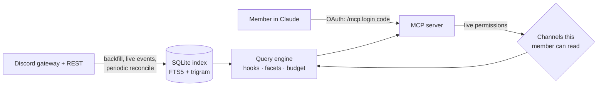

<div align="center">


# zerya-discord-mcp

**Permission-aware search over your whole Discord history, for Claude and other AI agents.**

Self-hosted MCP server · full-text index with a real query language · sign in with Discord · read-only by default

[](https://github.com/Zerya-Dev/zerya-discord-mcp/actions/workflows/ci.yaml)
[](LICENSE)
[](https://pypi.org/project/zerya-discord-mcp/)
[](https://www.python.org/)
[](https://modelcontextprotocol.io/)

</div>

> *"Where did we decide on the foundation logo?"* · *"Who deployed agroQ to Oracle and how?"* ·
> *"Summarise what changed in #backend this week and reply to Ola's question."*

Discord is where your team's decisions live, and its search is not built for an AI agent: 25 results per page,
no context around a hit, no synonyms, no inflection, and every bot-token MCP server exposes everything the bot can
see to everyone who uses it. **zerya-discord-mcp** indexes your server's history into SQLite and gives agents
**hooks**: the matching spot *plus the conversation around it*, filtered by what the asking member can see on
Discord **right now**.

## Why this one

| | zerya-discord-mcp | Typical Discord MCP servers |
|---|---|---|
| Search | Full-history index (FTS5 + trigram), lemmas, typo variants, phrase/OR/exclude, `in:` `from:` `after:` `has:` filters, facets | Discord API pass-through or a scan of one channel |
| Results | Hooks with surrounding messages, token budget, cursors | Raw message lists that overflow the context |
| Who sees what | Each member signs in; **their live Discord permissions** (roles, overwrites, private threads) filter every query in SQL | Everything the bot token can read |
| Connect | Remote MCP with built-in OAuth 2.1: paste a URL into claude.ai, run `/mcp login` | Local stdio + a bot token in a config file |
| Safety | Read-only by default, content wrapped as untrusted data, no pings, audit log | Often full admin tools |
| ToS | Regular bot, no self-bot or user token | Some use user tokens |

Works with **claude.ai** (custom connector), **Claude Code**, and any MCP client that supports remote servers with
OAuth. Bot UI and sign-in page in English and Polish.

## How it works



1. The bot backfills the history (resumable), follows new/edited/deleted messages, and re-reads the last days
   periodically so edits and deletes made while it was offline are applied. Deleted messages are removed.
2. A member adds the server as a connector; the sign-in page asks for a one-time code from `/mcp login` on
   Discord. That is the whole identity check: no passwords, no tokens to paste.
3. Every tool call computes the member's readable channels from their current roles and channel overwrites and
   constrains the SQL *before* ranking. Losing a role or leaving the server cuts access immediately.

## Quickstart (self-hosted)

You need a Discord application with a bot, a server you manage, and an HTTPS domain. Full guide:
**[docs/self-hosting.md](docs/self-hosting.md)**.

```bash
# 1. Bot: discord.com/developers → New Application → Bot → enable MESSAGE CONTENT and SERVER MEMBERS intents.
# 2. Run it (Docker; the image is non-root and keeps its index in /data):
docker run -d --name zerya-discord-mcp \
  -e DISCORD_BOT_TOKEN=... \
  -e ZDM_GUILD_ID=123456789012345678 \
  -e ZDM_PUBLIC_URL=https://mcp.example.com \
  -v zdm-data:/data -p 8000:8000 \
  ghcr.io/zerya-dev/zerya-discord-mcp-bot:latest
# 3. Put HTTPS in front of port 8000 (Dokploy/Traefik, Caddy, nginx) at the root of mcp.example.com.
# 4. The log prints a setup checklist and the invite link. On Discord, run /mcp-setup to see it there.
```

### Connect a client

| Client | How |
|---|---|
| **claude.ai** | Settings → Connectors → *Add custom connector* → `https://mcp.example.com/mcp` → Connect → paste the code from `/mcp login` |
| **Claude Code** | `claude mcp add --transport http discord https://mcp.example.com/mcp`, then `/mcp` in Claude Code to sign in |
| **Other MCP clients** | Remote server URL `https://mcp.example.com/mcp`; OAuth discovery, dynamic client registration and PKCE are supported |

On Discord: `/mcp login` (sign-in code), `/mcp list` (connected clients), `/mcp revoke <id|all>` (disconnect),
`/mcp-setup` (admins: setup checklist).

## Tools

| Tool | What it does |
|---|---|
| `search` | Query → ranked hooks with context, expansions shown ("fundacja → fundacji (lemma)"), facets by channel/author/month, narrowing hints, per-term hit counts when nothing matches |
| `read` | Messages in order around a link/ID, the latest in a channel or thread, from a date, or a forum's posts; paged by token budget |
| `info` | Server map with activity, a channel (topic, who writes, threads) or a person (roles, where and when they write) |
| `send` | *Optional (`ZDM_WRITE_ENABLED`).* Post or reply as the bot, signed with the member's name, only where that member may post, no pings, no link previews |

### Query language

```text
logo                    exact word, its lemma (logami → logo) and close spellings from your corpus
(fundacja|foundation)   any of the alternatives; groups are ANDed
"wersja mono"           exact phrase
-lego                   exclude
in:#design              channel (includes its threads), thread or forum
from:ola  mentions:ola  author / mentioned member (nick, display name or username)
after:2026-09  before:2026-10-01  after:7d
has:link  has:file  has:code   is:thread
```

Terms only need to occur within a few messages of each other (`context`, default 5), because conversations
spread one idea over several short messages.

## Security model

- **Identity:** OAuth 2.1 authorization server built in (RFC 8414 / 9728 discovery, dynamic client registration,
  PKCE S256, rotating refresh tokens with reuse detection, revocation). Codes and tokens are stored as SHA-256
  hashes. The sign-in page shows which site receives the code; `ZDM_OAUTH_REDIRECT_HOSTS` can restrict it.
- **Authorization:** computed per request from live Discord state; private threads use Discord's thread
  membership. Facets, counts, hints and channel mentions never reveal hidden channels.
- **Prompt injection:** message content is returned inside `<untrusted_discord_messages>`; tool descriptions and
  server instructions tell the agent not to follow it. Writing is off by default; when on, it is a separate OAuth
  scope the member approves, rate-limited, audited, without mentions or embeds.
- **Data:** your own SQLite file. Deleted messages are removed from the index. Excluded channels
  (`ZDM_EXCLUDE_CHANNEL_IDS`) never enter it. The audit log keeps tool calls for `ZDM_AUDIT_RETENTION_DAYS`.

Report vulnerabilities privately: see [SECURITY.md](SECURITY.md).

## Configuration

All settings are environment variables (or `.env`). The essentials:

| Variable | Default | |
|---|---|---|
| `DISCORD_BOT_TOKEN` | required | bot token |
| `ZDM_GUILD_ID` | required | the server to index and serve |
| `ZDM_PUBLIC_URL` | required for HTTP | origin of the app, e.g. `https://mcp.example.com` (OAuth issuer; MCP at `/mcp`) |
| `ZDM_DB_PATH` | `/data/zerya-discord-mcp.sqlite3` in Docker | index file |
| `ZDM_WRITE_ENABLED` | `false` | enable the `send` tool |
| `ZDM_EXCLUDE_CHANNEL_IDS` | `[]` | JSON list; channels (and their threads) never indexed |

Every other option (backfill limits, reconcile window, token lifetimes, rate limits, send allowlist, timezone,
output budgets, bot/HTTP switches) is documented in **[docs/configuration.md](docs/configuration.md)**.

## Embedding in an existing hikari bot

The library does everything except owning the bot and the HTTP server:

```python
from zerya_discord_mcp import Config, ZeryaDiscordMcp

zdm = ZeryaDiscordMcp(
    bot, Config(db_path=Path("/data/zdm.sqlite3"), guild_id=GUILD_ID, public_url="https://mcp.example.com")
)  # before bot.run()


@bot.listen(hikari.StartedEvent)
async def _(_: hikari.StartedEvent) -> None:
    await zdm.start()  # migrations, backfill and maintenance in the background


@bot.listen(hikari.StoppingEvent)
async def _(_: hikari.StoppingEvent) -> None:
    await zdm.stop()


app = zdm.asgi_app()  # serve at the root of ZDM_PUBLIC_URL (any thread; REST hops to the bot loop)
result = await zdm.commands.login(user_id, locale)  # wire /mcp into your command framework; result.to_embed()
```

```bash
pip install "zerya-discord-mcp[mcp]"     # or: uv add "zerya-discord-mcp[mcp]"
```

Needs the `MESSAGE_CONTENT` and `GUILD_MEMBERS` intents.

## Development

```bash
uv sync --all-packages
just test lint typecheck      # pytest, ruff, pyrefly (strict)
just index                    # run the bot locally without slash commands
just search "(logo|logotyp) after:2026-09"     # query a local index as an admin
just eval eval/questions.yaml  # recall@10 / MRR on your own questions
```

Search changes are measured on an eval set of real questions (see [eval/](eval/)); a change must not lower
recall@10.

## License

[Apache-2.0](LICENSE) © Zerya
